  <picture>
    <source media="(prefers-color-scheme: dark)" srcset="./assets/intro-dark.svg">
    <source media="(prefers-color-scheme: light)" srcset="./assets/intro-light.svg">
    
  </picture>

    

  <a href="https://www.linkedin.com/in/a-burak-ozer">
    <picture>
      <source media="(prefers-color-scheme: dark)" srcset="./assets/linkedin-dark.svg">
      <source media="(prefers-color-scheme: light)" srcset="./assets/linkedin-light.svg">
      
    </picture>
  </a>

 

### About

Software & platform engineer in İzmir, Türkiye. 5+ years across embedded Linux, telecom
infrastructure and, since 2022, building and running a cybersecurity product line end to end:
writing backend services, running the platform on Kubernetes on-prem and in the cloud,
integrating it with customers' security stacks and owning it in production.

- **Backend & security:** Python services, LDAP/Active Directory auth, RBAC, pentest
  remediation, ICAP and mail-security integrations, YARA/Sigma.
- **Platform:** Helm-packaged microservices on managed Kubernetes and on-prem K3s.
- **Production:** incident response and root-cause analysis on live systems, e.g. raising a
  file pipeline's limit from 35 MB to 4 GB and cutting recovery after a tunnel drop from up to
  20 minutes to about 30 seconds.

### Tech stack

